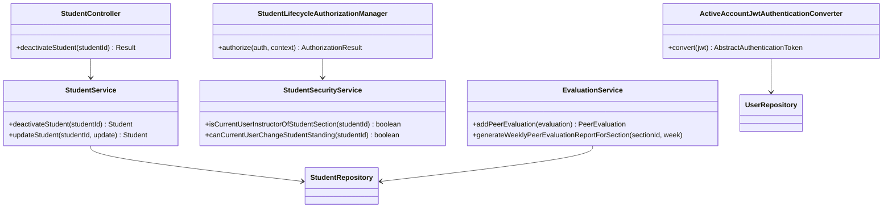
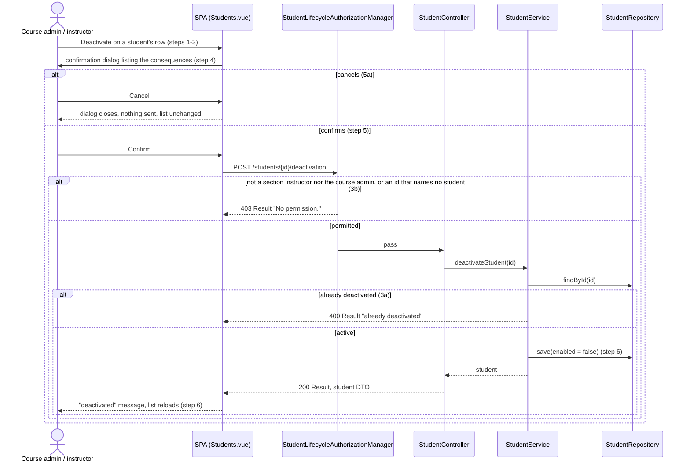
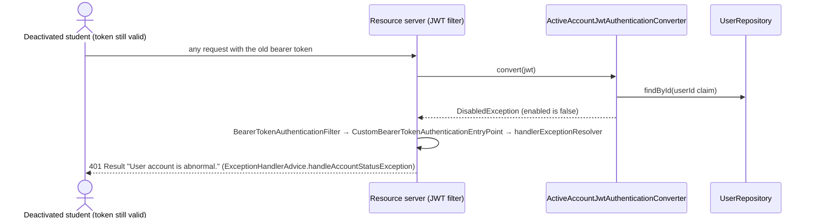

# Student (STU) Design

> Realizes: UC-STU-deactivate-student
> Depends on: BR-student-lifecycle (who may deactivate), BR-deactivated-student-standing (what deactivation leaves in place), BR-submission-owed, FR-SEC-active-account, CO-ferpa
> See: [use cases](../requirements/use-cases.md#student), [business rules](../requirements/business-rules.md), [architectural-design.md](architectural-design.md#shared-foundation-components) (shared-foundation component view, Crosscutting Concepts / Security & Compliance)
> Designed against `main` at `b9d21b0` (2026-11-05).

## Overview

The STU area is the `student` bounded context of the shared foundation: the student entity, its search, registration, update, and delete. This first design-of-record adds one thing to it, a dedicated **deactivate** action, and fixes what "deactivated" means across the product. Before this design, deactivation was a Status switch in the student edit form with no warning (`StudentService.updateStudent` set `enabled` along with the name and email), only login checked the flag, and the three places that read it disagreed: `SubmissionStatusService.findOwedItems` skipped deactivated students, `EvaluationService.generateWeeklyPeerEvaluationReportForSection` listed them forever, and `EvaluationService.addPeerEvaluation` let teammates keep evaluating them.

The use case touches three slices. The `student` slice owns the action and its route. The `security` slice owns who may call it and the per-request active-account check. The `evaluation` slice adopts BR-deactivated-student-standing in its two methods. Nothing moves between components; the architecture-of-record is unchanged.

## Components & classes

| Component | Files | Status |
|---|---|---|
| Route + action | `backend/.../student/StudentController.java` (`deactivateStudent`), `StudentService.java` (`deactivateStudent`; `updateStudent` no longer lowers `enabled`) | changed |
| Who may | `backend/.../student/StudentSecurityService.java` (`canCurrentUserChangeStudentStanding`), `backend/.../security/authorizationmanagers/StudentLifecycleAuthorizationManager.java`, `SecurityConfiguration.java` (one route rule) | new / changed |
| Active account per request | `backend/.../security/ActiveAccountJwtAuthenticationConverter.java`, registered as the resource server's JWT converter in `SecurityConfiguration.java` | new |
| Deactivated student in peer evaluations | `backend/.../evaluation/EvaluationService.java` (`addPeerEvaluation`, `generateWeeklyPeerEvaluationReportForSection`) | changed |
| UI | `frontend/src/pages/students/Students.vue` (Deactivate button + confirmation), `EditStudentForm.vue` (Status switch removed), `frontend/src/apis/student/index.ts` (`deactivateStudent`), `frontend/src/pages/evaluations/SubmitTeamsEvaluations.vue` (lists only active teammates) | changed |
| Reused as is | `Result` envelope, `ExceptionHandlerAdvice`, `StudentToStudentDtoConverter`, `UserRepository`, `ElMessageBox` | reused |

## Sequence

### UC-STU-deactivate-student: main success scenario and extensions

### FR-SEC-active-account: the deactivated student's next request

## API contract

| Endpoint or job | Caller (who may) | Request | Success | Errors, by extension |
|---|---|---|---|---|
| `POST /api/v1/students/{studentId}/deactivation` | An instructor assigned to the student's course section, or the course admin of her course (BR-student-lifecycle): `StudentLifecycleAuthorizationManager`; route rule added with the other `/students/**` rules, before the `denyAll()` catch-all | No body | `200`, message "Deactivate student successfully", data the student DTO (`StudentToStudentDtoConverter`, whose `enabled` field already exists) with `enabled: false`. Team, section, activities, and evaluations unchanged | 3b, anyone else including the student herself, and an id that names no student (the manager fails closed, so an outsider cannot tell a wrong id from a forbidden one): `403` `FORBIDDEN` "No permission.", no detail. 3a, already deactivated: `400` `INVALID_ARGUMENT`, message "This student is already deactivated." (a bare `IllegalArgumentException`; `ExceptionHandlerAdvice` already maps it). No token: `401`, as every route. The service's `ObjectNotFoundException` → `404` is reachable only by a delete racing the call |
| `PUT /api/v1/students/{studentId}` (existing) | unchanged (`UserOwnershipAuthorizationManager`) | `enabled` in the body is honored only when it raises the flag; `false` or absent leaves the flag as it is, with a `200` and no error, since the edit form no longer offers the control | unchanged | unchanged |
| Every authenticated route | unchanged | — | unchanged | A bearer token whose user (student or instructor) is deactivated: `401` `UNAUTHORIZED` "User account is abnormal.", the same envelope a deactivated login gets today, via the chain the second sequence diagram shows. A token whose `userId` names no user (deleted after login): the same `401` |
| `POST /api/v1/evaluations` (existing, one evaluation of one evaluatee per call) | unchanged | — | unchanged | Evaluatee deactivated: `PeerEvaluationIllegalArgumentException` → `400` `INVALID_ARGUMENT`, message "You cannot evaluate a deactivated teammate." (BR-deactivated-student-standing). Checked after the same-team check and before the duplicate check |

## Key decisions

**A dedicated action, not the edit form.** Deactivation is its own `POST` with its own route rule, and `updateStudent` can no longer lower `enabled`, so the warning and confirmation of step 4 cannot be bypassed (Associated Information). `updateStudent` may still raise the flag: that is the only reactivation path until UC-STU-reactivate-student is built, and the student edit form keeps no control for it, so only a direct API call can use it. Rejected: ignoring `enabled` in `updateStudent` entirely, which leaves a deactivated student with no way back. Rejected: keeping the Status switch as a second path, which skips the warning and the section-instructor check. Accepted for now: the interim raise is guarded by that route's `UserOwnershipAuthorizationManager`, which admits the section's instructors but not an admin-only course admin, narrower than BR-student-lifecycle; UC-STU-reactivate-student replaces the path when built. A deactivated student cannot use it on herself, since her token is refused first.

**POST, not PUT or DELETE.** The action is not idempotent (3a rejects the second call) and deletes nothing, which is the distinction the use case draws against UC-STU-delete-student. Rejected: `PUT /students/{id}/enabled` with a boolean, which would be both deactivate and reactivate on one route with one rule, when the two use cases may yet diverge (reactivation notifies the student; deactivation does not).

**Who may: a new manager, not `UserOwnershipAuthorizationManager`.** The existing manager for `/students/{studentId}` admits the student herself and the section's instructors, and not a course admin who is not assigned to the section. BR-student-lifecycle names the section instructor and the course admin and nobody else, so `StudentLifecycleAuthorizationManager` delegates to a new `StudentSecurityService.canCurrentUserChangeStudentStanding`, which loads the student once and checks the section-instructor clause and the course-admin clause. "Course admin" here is what it is everywhere in this codebase: the `Course.courseAdmin` of the student's course, resolved through her section, not any holder of `ROLE_admin` (the NOT design reads BR-role-based-access the same way). The manager reads `studentId` from the path and fails closed on an unknown or non-numeric id, as the rest of `StudentSecurityService` does, so an outsider probing ids learns nothing (3b, CO-ferpa); that is why the contract has no `404`. Rejected: `hasAuthority("ROLE_instructor")`, the rule `updateStudent` effectively had, which lets any instructor deactivate any student.

**Active account is checked on every request.** FR-SEC-active-account denies access "regardless of otherwise-valid credentials", but the resource server validated only the token's signature and expiry, so a deactivated student kept access for up to two hours. `ActiveAccountJwtAuthenticationConverter` (a `@Component` implementing `Converter<Jwt, AbstractAuthenticationToken>`, registered on `oauth2ResourceServer().jwt()` with `jwtAuthenticationConverter(...)`, since the resource server auto-detects only a bean of the concrete `JwtAuthenticationConverter` class; the current `jwtAuthenticationConverter()` bean becomes the delegate it wraps, keeping the `authorities` claim and empty prefix) loads the user by the token's `userId` claim with a primary-key read and throws `DisabledException` when the account is disabled, or when no user exists. Throwing is the contract of an authentication step, unlike the authorization guards that Crosscutting Concepts say never throw: `BearerTokenAuthenticationFilter` catches the `AuthenticationException`, hands it to `CustomBearerTokenAuthenticationEntryPoint`, which delegates to the `handlerExceptionResolver`, so `ExceptionHandlerAdvice.handleAccountStatusException` returns the same `401` "User account is abnormal." a disabled login gets. It covers instructors too, since FR-SEC-active-account does. Cost: one primary-key read per authenticated request on a table of under a hundred rows; no cache is designed (see Open questions). This is the trunk commit: it changes what every authenticated request does. Rejected: accepting the token window and documenting it, which makes the FR false for two hours. Rejected: shortening the token lifetime, which inconveniences everyone and still leaves a window. Rejected: a token denylist, which adds state for a case one read answers.

**Deactivation changes standing, not team membership.** `deactivateStudent` touches only `enabled` (BR-deactivated-student-standing). `findOwedItems` already excludes her from what teammates owe, so nothing else in the notification slice changes. Rejected: calling `Team.removeStudent`, which empties her team name on every past report and forces a manual reassignment on reactivation.

**Peer evaluations of a deactivated student are refused, and the report shows her only for weeks on record.** `addPeerEvaluation` rejects an inactive evaluatee, so the three readers of `enabled` now agree with BR-submission-owed: not owed means not accepted. The section report includes a student when she is active or when at least one evaluation of her exists for that week, which keeps her past weeks visible and drops the empty rows after her deactivation without storing a deactivation date. "An evaluation of her" is any `PeerEvaluation` whose evaluatee is she and whose stored `week` key is the report's week, her self-evaluation included. Only the section report changes: the per-student report (UC-EVA-student-evaluation-report) is asked for one student by id and already shows just what is on record, and weekly activity report listings are out of this use case's scope. Accepted consequence: a teammate who has not yet evaluated her for her last active week when she is deactivated cannot do so afterwards. Rejected: a `deactivatedAt` column, which adds a migration to answer a question the evaluations already answer.

**The UI lives on the student list, which is the details view.** `Students.vue` is where UC-STU-view-student is realized (its traceability row), so step 2 and 5a1's "the student's details" are the row the instructor is looking at. The Deactivate button sits in the Operations column beside Edit, shown only when `row.enabled` is true (3a never reaches the server from the UI). The confirmation is an `ElMessageBox.confirm` titled "Deactivate this student?", whose body is the consequences paragraph of the use case's Associated Information in plain words (no rule ids), with buttons "Deactivate" and "Cancel"; `beforeClose` sets `confirmButtonLoading` while the `POST` is in flight, so a second click sends nothing. On `200` the page shows `ElMessage.success` with the response message and refetches the current page with its filters, so the row's Status tag reads Disabled. A `403` or `404` is not handled in the page: the shared Axios instance already routes them to the forbidden and not-found pages, which is right for a stale row. The list is reachable only by instructors, and the search is scoped to the caller's default section, so a course admin not assigned to the section reaches the action only through the API. The student is not notified: the use case has no such step, and she is a secondary actor only because the action is about her. Rejected: the student dashboard (`/students/:studentId`), which is the performance view and has no administration controls.

## Data model

No delta. `Student.enabled` (inherited from `PeerEvaluationUser`) already carries the state; `Team`, `Section`, `Activity`, and `PeerEvaluation` rows are untouched, as the SRS's [Business Domain Model](../requirements/software-requirements-specification.md#business-domain-model) defines them.

## Reuse & cross-cutting

- Authorization: the `AuthorizationManager` pattern of `architectural-design.md`; `StudentSecurityService` gains one query, in the fail-closed style its class comment requires.
- Error envelope: `IllegalArgumentException` → `400` `INVALID_ARGUMENT`, `ObjectNotFoundException` → `404`, `AccessDeniedException` → `403`, `AccountStatusException` → `401`, all through the existing `ExceptionHandlerAdvice`.
- Security per request: Spring Security's `oauth2ResourceServer().jwt()` takes the converter bean; nothing else in the filter chain changes. Login (`DaoAuthenticationProvider`) already refuses a disabled account through `MyUserPrincipal.isEnabled()`.
- Frontend: `ElMessageBox.confirm` as in `Sections.vue`; the `request` Axios instance; `ElMessage` for the step-6 notice.

## Tests

| Use case, flow | Level | Asserts |
|---|---|---|
| UC-STU-deactivate-student main, section instructor | integration | Bill (`b.gates@abc.edu`, instructor of section 2) `POST`s for John: `200` with the success message, John's `enabled` is false, his team id is unchanged, and Bill's `POST /activities/search` for John and `GET /evaluations/students/{john}/week/{week}/details` still return his past rows (there is no `GET /activities/students/{id}` route; the instructor's view of one student's reports is the search with a `studentId` criterion) |
| UC-STU-deactivate-student main, course admin | integration | The course admin (`b.wei@abc.edu`), removed from section 2 through `SectionRepository` in the test so he is admin only, `POST`s: `200` |
| UC-STU-deactivate-student 3a | integration | A second `POST` for the same student: `400` with the already-deactivated message; the student stays deactivated and nothing else changes |
| UC-STU-deactivate-student 3b | integration | Tim Cook (`t.cook@abc.edu`, admin of another course) on John, and John (`j.smith@abc.edu`) on himself and on his teammate Eric: `403` with the `Result` envelope; the target stays active. No token: `401` |
| UC-STU-deactivate-student 3b, unknown id | integration | `POST` for an id that names no student, by a section instructor: `403`, the same envelope as a forbidden one |
| UC-STU-deactivate-student 5a | E2E (Cypress, API stubbed) | Cancelling the dialog sends no `POST`, and the row still shows Enabled |
| UC-STU-deactivate-student step 4 | E2E (Cypress, API stubbed) | The dialog names the consequences before Deactivate is offered; a deactivated row shows no Deactivate button; the edit dialog has no Status switch |
| BR-deactivated-student-standing, form | E2E (Cypress, API stubbed) | The peer evaluation form lists only teammates whose `enabled` is true |
| FR-SEC-active-account, per request | integration | John logs in, Bill deactivates him, John's next `GET /students/{john}` with the same token: `401` "User account is abnormal." |
| FR-SEC-active-account, login | integration | A deactivated student's `POST /users/login` with the right password: `401` |
| FR-SEC-active-account, instructor | integration | Bill logs in, his `enabled` is set false through `InstructorRepository`, his next request with the same token: `401` |
| FR-SEC-active-account, deleted user | integration | A validly signed token whose `userId` claim names no row (what a token looks like once its user is deleted): `401` |
| Trunk: `updateStudent` cannot lower `enabled` | unit | With `ROLE_instructor` answered by the mocked `UserUtils.hasRole` (the service reads the caller's role there, per Crosscutting Concepts, not from `SecurityContextHolder`), `updateStudent` with `enabled: false` leaves the student enabled and returns normally; with `enabled: true` on a deactivated student it raises it |
| BR-deactivated-student-standing, evaluate | unit and integration | `addPeerEvaluation` whose evaluatee is deactivated throws `PeerEvaluationIllegalArgumentException`; an active evaluatee on the same team is saved (unit). `POST /evaluations` for a deactivated teammate: `400` with the message (integration) |
| BR-deactivated-student-standing, report | unit | A deactivated student with one evaluation in week W is listed in W's report; the same student with none in W+1 is omitted from W+1's report; an active student with no evaluations is still listed |
| BR-submission-owed, teammates do not owe her | existing | `SubmissionStatusServiceTest` already asserts a deactivated teammate is neither listed nor required; cited, not rewritten |

## Open questions / risks

- **One read per request.** The converter adds a user lookup to every authenticated call. Not measured; at course scale (under a hundred users) it is a primary-key hit on a small table. If it ever shows in traces, cache the flag for the token's remaining lifetime rather than drop the check.
- **Two concurrent deactivations.** `Student` has no `@Version`; two `POST`s racing for the same active student may both return `200`. The result is the same row either way, so this is accepted.
- **Her last active week.** A teammate who had not yet evaluated her for the week before her deactivation cannot do so afterwards (BR-deactivated-student-standing). Accepted: what she received that week no longer feeds any grade of hers.
- **Reactivation by API only.** Until UC-STU-reactivate-student is built, raising `enabled` is possible only through `PUT /students/{id}` by a direct call. The edit form offers no control for it. Noted in that use case's Associated Information.
- **No frontend automated tests exist in this area today.** The two Cypress rows are the first; if the Cypress harness is not set up for stubbed API tests, they fall to a manual check named in the build pull request's Not verified.
